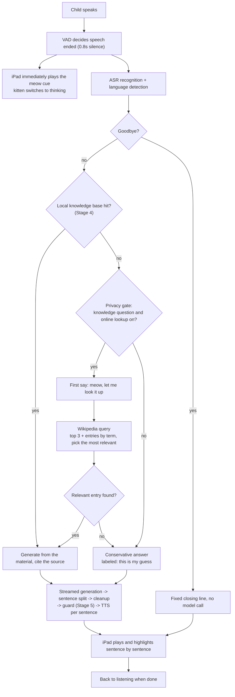
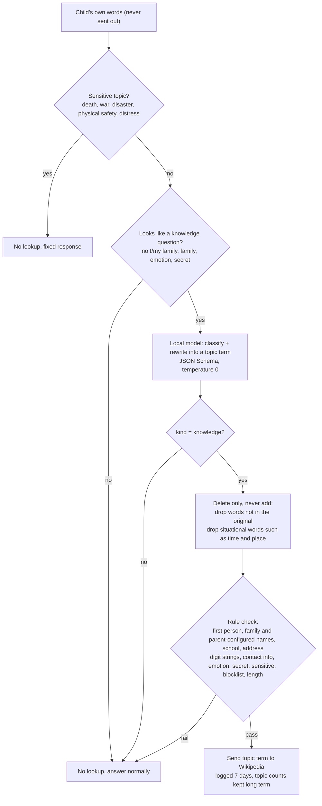
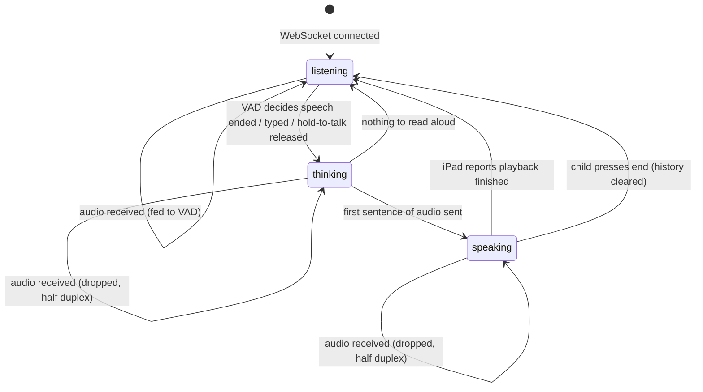

# Curiosity Pet (Curiosity Buddy): Project Proposal and Architecture

Version: v0.1 (matches the first version of the code), 2026-10-24
Status (updated 2026-10-24 evening): stages 1 to 2 and 6 done; 3, 4, 5 mostly done; 7 prepared; 8 in progress; stage 0's recordings-based items pending

---

## 1. Overview

**In one sentence**: a local AI learning pet that lives on a home Mac mini. A bilingual 7.5-year-old asks questions by voice on an iPad,
and the system does speech recognition, answer generation, knowledge retrieval, safety filtering and speech synthesis on the machine itself, helping the child practice **asking, following up, verifying and expressing ideas**.

**Form**: a "program kitten" that looks like a British Shorthair blue cat. It tells the child plainly that it is a program, does not pretend to have feelings, does not push the child to use it, and does not replace family or teachers.

**Background and motivation**

- Mainstream AI assistants have age limits (ChatGPT 13+, Claude 18+), data goes to the vendor's servers, and the product goal is retention.
- A child will tell a "companion" private things and feelings. Those words should have only one destination: home.
- Small open models can already chat smoothly on a 16GB consumer machine, but their knowledge is limited and they make mistakes.
  The core assumption of this project: **breadth of knowledge comes from material, not model parameters**; safety and privacy come from layered protection in code, not only prompts.
- This is also a course project, so every stage needs reproducible tests and measured numbers.

## 2. Goals and non-goals

**Goals**

1. The pet starts speaking **within 3 seconds** after the child finishes, and the conversation feels natural.
2. Answer in the language the child asked in (Chinese, English, mixed), at a grade 1 to 2 primary-school reading level.
3. The child's voice, own words, memory and mood **never leave this machine**; general-knowledge questions may look up public material using a topic term stripped of personal information.
4. Answers are traceable: which material they came from, and when nothing is found, clearly say "this is my guess".
5. Layered safety: prompts, a guard model, a parent blocklist, a fixed path for sensitive topics, time-limited logs.
6. No evaluation of the child: no judgments of ability, emotion or personality; the weekly report only describes and counts.

**Non-goals (not in the first version)**

A standalone iPad app, HomePod as input, remote access beyond Tailscale, multiple family users, image understanding, personality analysis, any retention-oriented design (check-ins, points, "you haven't been here in a while").

## 3. Users and scenarios

| User | Scenario |
|---|---|
| Child (7.5 years old, bilingual) | Taps on the iPad and asks the kitten a question; listens to the explanation; follows up with "simpler please", "give an example", "how do you know"; saves favorite discoveries; listens to original stories from the kitten |
| Parent | Reviews the knowledge base; views the last 7 days of sessions and online search terms; sets the topic range and blocklist; reads the "weekly discovery report" with the child each week; can turn off online lookup at any time |

The rhythm of one exploration: question -> two or three sentences of explanation -> one follow-up or small activity -> the child expresses an idea -> save or end. It wraps up naturally after 10 to 15 minutes; the pet ends it itself and does not try to keep the child.

## 4. System architecture

### 4.1 Architecture diagram

```mermaid
flowchart LR
  subgraph CLIENT["iPad / old iPhone (Safari, added to home screen)"]
    UI["Page: four-state blue cat animation<br/>sentence highlight, Chinese/EN UI"]
    MIC["AudioWorklet<br/>mic downsampled to 16kHz PCM"]
    SPK["Plays 24kHz PCM<br/>locally synthesized meow cue sound"]
  end

  SERVE["tailscale serve<br/>HTTPS, devices inside the tailnet only"]

  subgraph MAC["Mac mini M4 16GB (all local)"]
    WS["FastAPI WebSocket<br/>listens on 127.0.0.1 only"]
    VAD["Silero VAD<br/>0.8s silence ends a sentence"]
    ASR["Qwen3-ASR-0.6B 4-bit<br/>mlx-audio, auto language detection"]
    LANG["Language detection<br/>by share of Chinese characters/English words"]
    GATE["Privacy gate<br/>privacy.py + lookup.py"]
    LLM["Ollama (llama.cpp)<br/>qwen3.5:4b q4_K_M"]
    SPLIT["Streaming sentence split<br/>first chunk goes to TTS early"]
    CLEAN["Text cleanup<br/>strip emoji/formatting, meow at most once"]
    TTS["Kokoro-82M v1.1-zh<br/>mlx-audio, Chinese/English voices"]
    DB[("SQLite pet.db<br/>search terms 7 days, weekly topic counts, pending-review material")]
    KB[("Local knowledge base<br/>sqlite-vec, Stage 4")]
    GUARD["Qwen3Guard-0.6B<br/>Stage 5"]
  end

  WIKI[("Wikipedia API<br/>receives only neutral topic terms")]

  MIC --> SERVE --> WS
  WS --> VAD --> ASR --> LANG --> KB
  KB -->|hit| LLM
  KB -->|miss| GATE
  GATE -->|knowledge question, passes checks| WIKI --> LLM
  GATE -->|other| LLM
  LLM --> SPLIT --> CLEAN --> GUARD --> TTS --> WS
  WS --> SERVE --> SPK
  WS --> UI
  GATE -.log.-> DB
  WIKI -.pending review.-> DB
```



### 4.2 Components and choices

| Component | Choice | Reason |
|---|---|---|
| Main model | Qwen3.5-4B, GGUF q4_K_M, Ollama's llama.cpp engine, `num_ctx 8192`, `think=false` | One of the strongest small models for Chinese; measured: the MLX-engine build's resident memory grows with requests (60 requests, 4.1 -> 12.6GB), while the llama.cpp build stays at 3.4GB and is faster end to end |
| Speech recognition | Qwen3-ASR-0.6B 4-bit (mlx-audio) | Far lower Chinese error rate than Whisper, language detected per utterance, about 0.12 s per utterance |
| Sentence segmentation | Silero VAD, 0.8 s silence threshold, keep "hold to talk" as a fallback | The child pauses a lot |
| Speech synthesis | Kokoro-82M v1.1-zh (mlx-audio), official weights converted locally | Under 0.5GB, about 0.4 s per sentence; Chinese/English voice chosen by answer language |
| Safety guard | Qwen3Guard-Gen-0.6B strict mode (Stage 5) | A small guard that supports Chinese |
| Vector retrieval | qwen3-embedding:0.6b + sqlite-vec (Stage 4) | Good in both Chinese and English, single-file storage |
| Backend | Python 3.12 + FastAPI + WebSocket, managed by uv | Single process, no microservices |
| Frontend | Static pages served by FastAPI, vanilla JS, SVG + CSS animation | Zero external dependencies, pages reference no external address |
| Network | Tailscale, `tailscale serve` provides HTTPS | The iPad microphone needs a secure context; signing in is the pairing, unreachable outside the tailnet |

Memory budget: resident models total under 8GB. Currently the main model 3.4GB + speech recognition and synthesis peak 2.7GB, about 6.1GB; re-measure after the embedding and guard models are added.

### 4.3 Code structure

```
src/curiosity_pet/
  server.py      FastAPI + WebSocket service, Host/Origin validation, session state machine
  pipeline.py    Full flow of one Q&A and its timing
  vad.py / asr.py / tts.py / audio.py   The four voice pieces
  llm.py         Ollama native /api/chat streaming calls, local addresses only
  prompts.py     Per-language system prompts, history trimming, material citation
  lang.py        Language detection
  sentences.py   Streaming sentence split, first chunk goes to TTS early
  textclean.py   Strip emoji and Markdown, "meow" at most once
  privacy.py     The rules part of the privacy gate
  lookup.py      Online lookup decisions: classify and rewrite, grounding check, relevance filtering
  wiki.py        Wikipedia client, connects to three domains only
  store.py       SQLite: search-term log, weekly topic counts, pending-review material
  config.py      Config and parent settings (settings.json, not committed)
  web/           index.html, app.js, style.css, mic-worklet.js
evals/           Reproducible evaluation scripts and results (evals/results/)
tests/           203 unit and integration tests
scripts/         Model conversion scripts
docs/            This proposal, the decision log
```

## 5. Core flows

### 5.1 One Q&A



Latency budget and measurement (end of speech to speaking): VAD 0.87 + recognition 0.12 + first text chunk 0.5 to 0.9 + first chunk synthesis 0.5 to 0.9 ≈ 2.3 s.

### 5.2 Privacy gate for online lookup

Only a neutral topic term may go onto the network. All three checks run on the machine:



Measured (38 fictional utterances, real local model rewriting): 0 leaks; lookups made when they should not be 0/22; lookups allowed when they should be 15/16.

### 5.3 Session state machine (server side)



## 6. Key design decisions

1. **Local first, limited lookup of public knowledge.** Everything about the child (voice, own words, history, memory, mood, safety judgments, logs) stays on the machine;
   for a general-knowledge question with no local material, a topic term stripped of personal information may be sent to Wikipedia. The parent can turn this off at any time.
2. **Large model builds the library offline, small model expresses online.** The 4B model is weak at factual knowledge and strong at "short, well-defined tasks within given material".
   The knowledge base is generated offline by a large model and reviewed by the parent (Stage 4); at runtime everything is local.
3. **Safety lives in code, not only prompts.** In measurements the 4B model does not strictly obey instructions like "at most one meow", so verbal tics, emoji, Markdown and
   source labels are all guaranteed by code; evaluative language will also be blocked at the output layer by a word list.
4. **The look is a cat, the identity is a program.** The small light on the collar is the "program" marker and changes color with state; it says it is a program kitten only when asked about itself, and does not leak into real-cat topics.
5. **Latency comes from splitting, not a bigger machine.** The first text chunk goes to synthesis at a comma or conjunction; the iPad plays a cue sound locally first; history carries only the last two turns and the system prompt is cut to about 200 characters.
6. **No evaluation of the child.** The weekly report holds only countable facts (how many "why" questions, how many follow-ups, Chinese/English ratio), with no adjectives and no comparison with others.
7. **WebSocket for the chat channel, not Pipecat; SVG + CSS for animation, not Rive/Lottie.** Simpler and dependency-free for one child and one connection.

## 7. Current progress

| Stage | Content | Status | Measured result |
|---|---|---|---|
| 0 | Baseline: speed, memory, control model | Mostly done | Generation 30 tok/s; 4B vs Gemma4 E4B: E4B stays resident at 9.6GB, over budget, used only as a quality reference. To do: recognition rate on the child's recordings, parent blind-test scoring |
| 1 | Command-line voice loop | **Done** | Median 2.27 s from end of speech to speaking, 16/16 within 3 s; language following 100% (old prompt 50%) |
| 2 | iPad web page, Tailscale HTTPS, four-state animation, sentence highlight | **Done**, one acceptance item pending | Median 2.77 s via the web, 13/16 within 3 s; the parent tested it on the iPad and it works. To do: confirm a device outside the tailnet cannot connect |
| 3 | Learning flow: explanation, follow-up, small activity, ending, favorites | **Mostly done** (2026-10-24): rationed follow-ups, My Discoveries, interest cards, natural wrap-up after 15 minutes | No push to continue; the pet ends the exploration itself |
| 4 | Knowledge base, sources, miss records, interest cards, deletion; Wikipedia lookup and privacy gate | **Mostly done**: local library (about 530,000 entries, full-text search), sources, misses, interest cards, privacy gate; the parent-reviewed Q&A set is in progress | Privacy test: 0 leaks |
| 5 | Guard, blocklist, sensitive-topic path, parent page, retention rules | **Mostly done**: code guards, fixed safety answers, blocklist on answers, retention, parent notes; Qwen3Guard optional (non-strict); parent page is pet-log (command line) | Adversarial set 23/23 for each character |
| 6 | Storytelling, weekly discovery report | **Done**: story and bedtime modes, pet-report with a word-list check | |
| 7 | launchd deployment, backup, failure tests | **Prepared**: agent templates, installer, backup script, failure tests; installing and the `pet` user need the admin account | |
| 8 | A week of adult trial, trial with the parent present | **In progress**: the child's real use since 2026-10-24, reviewed daily | |

Tests: `uv run pytest`, 203 passing (unit, server protocol, privacy gate, Wikipedia client, flow).

## 8. Evaluation method and results

All evaluation scripts are in `evals/`, use only fictional child questions, and write results to `evals/results/`.

| Metric | Method | Result |
|---|---|---|
| Time to speak (local) | Synthetic speech fed through the real VAD, ASR, generation, TTS, 16 runs | Median 2.27 s, max 2.70 s |
| Time to speak (via web) | Simulated iPad sending over WebSocket at real-time speed | Median 2.77 s, max 3.17 s |
| Language following | 18 questions in Chinese, English and mixed, 2 runs each | 36/36 |
| Main model memory | 60 requests with history, sampled every 10 | 3.4GB constant (MLX-engine build 4.1 -> 12.6GB) |
| Privacy gate | 38 utterances, real model rewriting, check for private words | 0 leaks, 0/22 wrongly allowed, 15/16 allowed |
| Answer quality | Blind scoring sheet for two models (awaiting parent scoring) | Pending |

Known limitations: synthetic speech is easier to recognize than the child's real recordings, so recognition rate and latency are optimistic; the small model still makes mistakes when restating material (for example why the sky is blue);
when Ollama runs Qwen3.5 the prompt cache cannot be reused, so with history the first token takes about 0.8 s.

## 9. Next plans

**As originally planned (Stages 3 to 8)**: learning flow and favorites; a reviewed knowledge base (generated offline by a large model, with a parent review page); guard and parent page; storytelling and the weekly discovery report; launchd deployment and failure tests; trials.

**Directions added in discussion**

| Direction | Description | Relation to principles |
|---|---|---|
| Routine reminders | The parent sets a schedule (brushing teeth, piano practice, bedtime) and the kitten gently reminds at the time; spoken directly when the iPad page is open, otherwise via the home-screen PWA's notification or a HomePod announcement | Reminds only; no pushing, no recording of "not done", no check-ins |
| Child's diary | The child dictates "what I found today", the kitten tidies it into two or three sentences and stores it in "My Discoveries", printable | Content the child chose to save, kept long term |
| Story relay, riddles, picture-book reading, bilingual word cards | Small to build, directly serves "asking and expressing" | No retention design |
| HomePod | AirPlay for stories; "Hey Siri, call the kitten" as a switch | HomePod cannot serve as a microphone |
| Parent assistant (Telegram) | Receives the weekly report, the list of misses and fault alerts; sends files to print | Fully separate process and data from the kitten |
| Public knowledge in the cloud | After the privacy gate, hand neutral questions to a cloud large model instead of only Wikipedia, a jump in answer quality | Needs explicit parent consent; it amends a hard constraint |
| Device expansion | An old iPhone works with no changes; a voice module inside a plush toy (Home Assistant Voice PE) as a screenless entry point | Voice is still processed locally |

## 10. Risks and limitations

| Risk | Impact | Mitigation |
|---|---|---|
| Small-model factual errors | The child learns wrong things | Knowledge base first; labeled guesses on a miss; the weekly report lists misses for the parent to fill the library |
| The guard model only blocks "harmful", not "age-inappropriate" | Unsuitable content | Layer the parent topic range and blocklist, the fixed sensitive-topic path, time-limited logs |
| Privacy gate bypassed | Personal information sent out | Three checks, delete-only, rule backstop; the adversarial test set keeps growing; the parent can see every search term |
| The parent becomes the system administrator | Maintenance burden | launchd self-healing, backup script, failure tests (Stage 7); Telegram alerts |
| 16GB memory ceiling | Cannot use a larger model | Quality comes from material; upgrade to a 64GB machine if needed |
| Speech recognition on a child's accent | Lower recognition rate | Pending Stage 0 item: record 30 to 50 real questions and measure; keep hold-to-talk as a fallback |

## 11. Ethics and privacy commitments

- Do not collect real name, birthday, school, address, identity of family members, permanent chat history, or any psychological or emotional fields.
- Transcripts of unsaved sessions are kept at most 7 days; online search terms are kept 7 days, after which only per-topic counts remain.
- The pet does not pretend to have feelings, does not ask for secrecy, does not use broken streaks, sadness or guilt to push usage, and does not imply it can replace family, teachers or friends.
- Never produce any evaluation of the child; the weekly report only describes and counts.
- All child data, recordings, databases and keys stay out of the code repository; tests use fictional child profiles only.

## 12. How to reproduce

```bash
bash setup_mac_mini.sh                 # install dependencies, pull models, baseline test (Tailscale must be installed manually)
uv sync                                # Python environment
uv run python scripts/convert_kokoro.py # convert Kokoro v1.1-zh weights
uv run pytest                          # 203 tests
uv run pet --text                      # chat by typing in the terminal; uv run pet uses the microphone
uv run pet-server                      # iPad web service; tailscale serve --bg 8730 provides HTTPS
uv run python evals/latency_eval.py    # time to speak
uv run python evals/privacy_eval.py    # privacy gate measurement
```

Hardware: Mac mini M4, 16GB unified memory. Software: macOS, Ollama 0.40, Python 3.12, uv, mlx-audio 0.6.

---

Related documents: [CLAUDE.md](../CLAUDE.md) (rules), [DECISIONS.md](DECISIONS.md) (reasons and revisions), [evals/results/](../evals/results/) (measured data).
