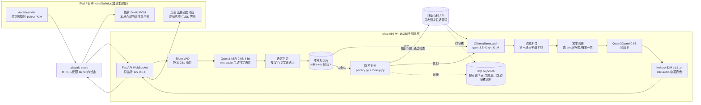
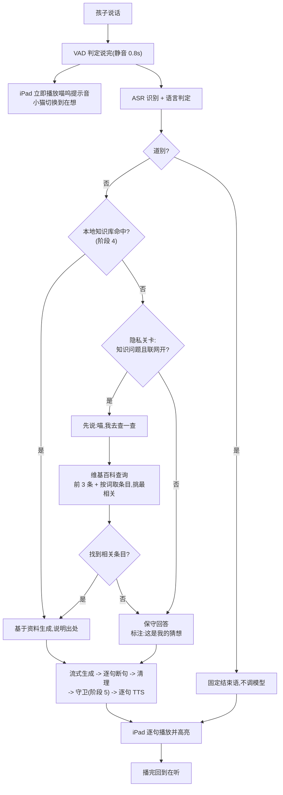
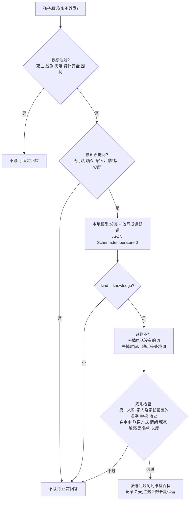
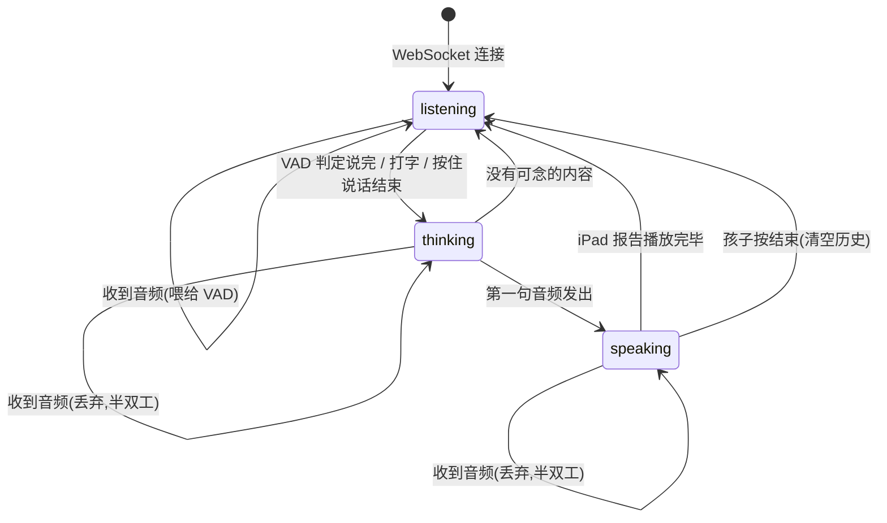

# Curiosity Pet(好奇心伙伴):项目提案与架构说明

版本:v0.1(第一版代码对应),2026-10-24
状态:阶段 0 至 2 已完成,阶段 4 部分完成(联网查询与隐私关卡),其余进行中

---

## 1. 项目概述

**一句话**:一只运行在家用 Mac mini 上的本地 AI 学习宠物。7 岁半的中英双语孩子在 iPad 上用语音提问,
系统在本机完成语音识别、回答生成、资料检索、安全过滤和语音合成,帮助孩子练习**提问、追问、验证和表达**。

**形态**:一只英短蓝猫样子的"程序小猫"。它明确告诉孩子自己是程序,不假装有感受,不催促使用,不替代家人和老师。

**背景与动机**

- 主流 AI 助手有年龄门槛(ChatGPT 13 岁以上,Claude 18 岁以上),数据进入厂商服务器,产品目标是留存。
- 孩子会对一个"伙伴"说出私人的事和心情。这些话的归宿应该只有一个地方:家里。
- 小型开源模型已经能在 16GB 的消费级机器上流畅对话,但知识有限、容易出错。
  本项目的核心假设是:**知识的广度靠资料,不靠模型参数**;安全和隐私靠程序层的分层防护,不只靠提示词。
- 这同时是一个课程项目,所有阶段都要有可复现的测试和实测数字。

## 2. 目标与非目标

**目标**

1. 孩子说完到宠物开口 **3 秒内**,对话自然。
2. 用孩子提问的语言回答(中文、英文、中英混说),阅读难度在小学一二年级。
3. 孩子的声音、原话、记忆、心情**不离开这台机器**;一般知识问题可以用去掉个人信息的话题词查公共资料。
4. 回答可追溯:来自哪条资料,查不到时明确说"这是我的猜想"。
5. 多层安全:提示词、守卫模型、家长黑名单、敏感话题固定路径、限期日志。
6. 不评价孩子:不做能力、情绪、性格判断,周报只做描述和统计。

**非目标(第一版不做)**

独立 iPad App、HomePod 作为输入、Tailscale 以外的远程访问、家庭多用户、图像理解、性格分析、任何留存设计(打卡、积分、"你好久没来了")。

## 3. 用户与场景

| 用户 | 场景 |
|---|---|
| 孩子(7 岁半,中英双语) | 在 iPad 上点一下,对小猫提问;听解释;追问"再简单一点""举个例子""你怎么知道的";收藏喜欢的发现;听小猫讲原创故事 |
| 家长 | 审核知识库;查看 7 天内的会话和联网搜索词;设置主题范围和黑名单;每周和孩子一起看"发现周报";随时关闭联网 |

一次探索的节奏:提问 -> 两三句解释 -> 一个追问或小活动 -> 孩子表达 -> 保存或结束。10 到 15 分钟自然收尾,宠物主动结束,不挽留。

## 4. 系统架构

### 4.1 架构图



### 4.2 组件与选型

| 组件 | 选择 | 理由 |
|---|---|---|
| 主模型 | Qwen3.5-4B,GGUF q4_K_M,Ollama 的 llama.cpp 引擎,`num_ctx 8192`,`think=false` | 中文最强的小模型之一;实测 MLX 引擎版常驻内存随请求持续增长(60 次请求 4.1 -> 12.6GB),llama.cpp 版稳定在 3.4GB 且端到端更快 |
| 语音识别 | Qwen3-ASR-0.6B 4-bit(mlx-audio) | 中文错误率远低于 Whisper,每句自动判定语言,单句约 0.12 秒 |
| 断句 | Silero VAD,静音阈值 0.8 秒,保留"按住说话"兜底 | 孩子停顿多 |
| 语音合成 | Kokoro-82M v1.1-zh(mlx-audio),官方权重本机转换 | 不到 0.5GB,一句约 0.4 秒;按回答语言切换中文、英文音色 |
| 安全守卫 | Qwen3Guard-Gen-0.6B 严格模式(阶段 5) | 支持中文的小型守卫 |
| 向量检索 | qwen3-embedding:0.6b + sqlite-vec(阶段 4) | 中英都好,单文件存储 |
| 后端 | Python 3.12 + FastAPI + WebSocket,uv 管理 | 单进程,不用微服务 |
| 前端 | FastAPI 托管的静态页面,原生 JS,SVG + CSS 动画 | 零外部依赖,页面不引用任何外部地址 |
| 网络 | Tailscale,`tailscale serve` 提供 HTTPS | iPad 麦克风需要安全上下文;登录即配对,tailnet 外不可达 |

内存预算:常驻模型合计 8GB 以内。当前主模型 3.4GB + 语音识别与合成峰值 2.7GB,约 6.1GB;向量与守卫模型接入后需复测。

### 4.3 代码结构

```
src/curiosity_pet/
  server.py      FastAPI + WebSocket 服务,Host/Origin 校验,会话状态机
  pipeline.py    一次问答的完整流程与计时
  vad.py / asr.py / tts.py / audio.py   语音四件套
  llm.py         Ollama 原生 /api/chat 流式调用,只允许本机地址
  prompts.py     分语言系统提示,历史裁剪,资料引用
  lang.py        语言判定
  sentences.py   流式断句,第一块提前送 TTS
  textclean.py   去 emoji、Markdown,"喵"限一次
  privacy.py     隐私关卡的规则部分
  lookup.py      联网查询决策:分类改写、落地检查、相关性筛选
  wiki.py        维基百科客户端,只连三个域名
  store.py       SQLite:搜索词日志、主题周计数、待审核资料
  config.py      配置与家长设置(settings.json,不入库)
  web/           index.html, app.js, style.css, mic-worklet.js
evals/           可复现的评测脚本与结果(evals/results/)
tests/           161 项单元与集成测试
scripts/         模型转换脚本
docs/            本提案、决策记录
```

## 5. 核心流程

### 5.1 一次问答



延迟预算与实测(说完到开口):VAD 0.87 + 识别 0.12 + 首块文字 0.5 至 0.9 + 首块合成 0.5 至 0.9 ≈ 2.3 秒。

### 5.2 联网查询的隐私关卡

发到网络上的只能是中性的话题词。三道关全部在本机:



实测(38 条虚构语句,真实本地模型改写):泄漏 0 条;不该联网却联网 0/22;该联网的放行 15/16。

### 5.3 会话状态机(服务端)



## 6. 关键设计决策

1. **本地优先,公共知识有限外查。** 和孩子本人有关的一切(声音、原话、历史、记忆、心情、安全判断、日志)留在本机;
   一般知识问题在本地没有资料时,可把去掉个人信息的话题词发给维基百科。家长可随时关闭。
2. **大模型离线建库,小模型在线表达。** 4B 模型弱在事实知识,强在"给定材料范围内做短而明确的事"。
   知识库由大模型离线生成、家长审核(阶段 4),运行时全部本地。
3. **安全靠程序层,不只靠提示词。** 实测 4B 模型不严格遵守"最多一个喵"之类的指令,所以口癖、emoji、Markdown、
   出处标注等都由程序保证;评价性用语也将由词表在输出层拦截。
4. **形象是猫,身份是程序。** 项圈上的小灯是"程序"标记,随状态变色;只有被问到自己时才说明是程序小猫,不串到真猫话题上。
5. **延迟靠拆分,不靠更大的机器。** 第一块文字在逗号或连词处就送合成;iPad 本地先播提示音;历史只带最近两轮、系统提示压到约 200 字。
6. **不评价孩子。** 周报只有可数的事实("为什么"问了几次、追问几次、中英文比例),不写形容词,不和别人比较。
7. **聊天通道用 WebSocket,不用 Pipecat;动画用 SVG + CSS,不用 Rive/Lottie。** 单孩子单连接的场景下更简单,零外部依赖。

## 7. 当前进度

| 阶段 | 内容 | 状态 | 实测结果 |
|---|---|---|---|
| 0 | 基线:速度、内存、对照模型 | 大部分完成 | 生成 30 tok/s;4B 对比 Gemma4 E4B:E4B 常驻 9.6GB 超预算,只作质量参照。待做:孩子录音的识别率、家长盲测评分 |
| 1 | 命令行语音闭环 | **完成** | 说完到开口中位数 2.27 秒,16/16 在 3 秒内;语言跟随 100%(旧提示 50%) |
| 2 | iPad 网页、Tailscale HTTPS、四态动画、逐句高亮 | **完成**,一项验收待做 | 经网页中位数 2.77 秒,13/16 在 3 秒内;家长在 iPad 实测可用。待做:用 tailnet 外设备确认不可访问 |
| 3 | 学习流程:解释、追问、小活动、结束、收藏 | 未开始 | |
| 4 | 知识库、出处、未命中记录、兴趣卡片、删除;维基百科联网与隐私关卡 | **联网与隐私关卡完成**,知识库未开始 | 隐私实测泄漏 0;七龙珠的孙悟空、恐龙灭绝、Goku 等能答对并说明出处 |
| 5 | 守卫、黑名单、敏感话题路径、家长页、保留规则 | 未开始(隐私关卡已含部分敏感话题拦截) | |
| 6 | 讲故事、发现周报 | 未开始 | |
| 7 | launchd 部署、备份、故障测试 | 未开始 | |
| 8 | 成人试用一周,家长陪同试用 | 未开始 | |

测试:`uv run pytest`,161 项通过(单元、服务端协议、隐私关卡、维基百科客户端、流程)。

## 8. 评估方法与结果

所有评测脚本在 `evals/`,只用虚构的儿童问题,结果写入 `evals/results/`。

| 指标 | 方法 | 结果 |
|---|---|---|
| 开口延迟(本机) | 合成语音喂进真实 VAD、ASR、生成、TTS,16 次 | 中位数 2.27 秒,最大 2.70 秒 |
| 开口延迟(经网页) | 模拟 iPad 按实时速度经 WebSocket 发送 | 中位数 2.77 秒,最大 3.17 秒 |
| 语言跟随 | 18 道中、英、混说题,各 2 次 | 36/36 |
| 主模型内存 | 60 次带历史请求,每 10 次采样 | 3.4GB 不变(MLX 引擎版 4.1 -> 12.6GB) |
| 隐私关卡 | 38 条语句,真实模型改写,检查私密词 | 泄漏 0,误放 0/22,放行 15/16 |
| 回答质量 | 两模型盲测评分表(待家长评分) | 待定 |

已知局限:合成语音比孩子真实录音容易识别,识别率和延迟偏乐观;小模型复述资料仍会出错(如天空为什么是蓝色的);
Ollama 运行 Qwen3.5 时无法复用提示缓存,带历史后首字约 0.8 秒。

## 9. 后续计划

**按原计划(阶段 3 至 8)**:学习流程与收藏;审核知识库(大模型离线生成,家长审核页面);守卫与家长页;讲故事与发现周报;launchd 部署与故障测试;试用。

**讨论中新增的方向**

| 方向 | 说明 | 与原则的关系 |
|---|---|---|
| 作息提醒 | 家长设置时间表(刷牙、练琴、睡前),到点小猫温和提醒;iPad 页面打开时直接说,否则通过主屏幕 PWA 的通知或 HomePod 播报 | 只提醒,不催促、不记"没做到"、不打卡 |
| 儿童日记 | 孩子口述"今天发现了什么",小猫整理成两三句,存入"我的发现",可打印 | 孩子主动保存的内容,长期保留 |
| 故事接龙、猜谜、绘本伴读、双语词卡 | 开发量小,直接服务"提问与表达" | 无留存设计 |
| HomePod | AirPlay 播故事;"嘿 Siri,叫小猫"作为开关 | HomePod 不能作为麦克风 |
| 家长助手(Telegram) | 接收周报、未命中清单、故障警报;发文件打印 | 与小猫完全分离的进程和数据 |
| 公共知识上云 | 隐私关卡之后,把中性问题交给云端大模型而非只查维基百科,回答质量跳一档 | 需家长明确同意,属于修改硬性约束 |
| 设备扩展 | 旧 iPhone 零改动可用;毛绒玩具内置语音模块(Home Assistant Voice PE)作为无屏幕入口 | 语音仍在本机处理 |

## 10. 风险与限制

| 风险 | 影响 | 对策 |
|---|---|---|
| 小模型事实错误 | 孩子学到错的 | 知识库优先;未命中标注猜想;周报列出未命中问题供家长补库 |
| 守卫模型只拦"有害",拦不了"不适龄" | 内容不合适 | 叠加家长主题范围与黑名单、敏感话题固定路径、限期日志 |
| 隐私关卡被绕过 | 个人信息外发 | 三道关、只删不加、规则兜底;对抗测试集持续扩充;家长可见每条搜索词 |
| 家长成为系统管理员 | 维护负担 | launchd 自愈、备份脚本、故障测试(阶段 7);Telegram 警报 |
| 16GB 内存上限 | 无法换更大模型 | 质量靠资料;必要时升级到 64GB 机器 |
| 语音识别对孩子口音 | 识别率下降 | 阶段 0 待做项:录 30 至 50 句真实提问实测,保留按住说话兜底 |

## 11. 伦理与隐私承诺

- 不收集真实姓名、生日、学校、地址、家人身份、永久聊天记录、任何心理或情绪字段。
- 未收藏的会话原文最多保留 7 天;联网搜索词保留 7 天,之后只留按主题的计数。
- 宠物不假装有感受,不要求保密,不用断签、伤心、内疚催促使用,不暗示能替代家人老师朋友。
- 不生成对孩子的任何评价;周报只做描述和统计。
- 所有儿童数据、录音、数据库、密钥不进代码仓库;测试只用虚构儿童档案。

## 12. 复现方法

```bash
bash setup_mac_mini.sh                 # 安装依赖、拉取模型、基线测试(Tailscale 需手动安装)
uv sync                                # Python 环境
uv run python scripts/convert_kokoro.py # 转换 Kokoro v1.1-zh 权重
uv run pytest                          # 161 项测试
uv run pet --text                      # 命令行打字对话;uv run pet 用麦克风
uv run pet-server                      # iPad 网页服务;tailscale serve --bg 8730 提供 HTTPS
uv run python evals/latency_eval.py    # 开口延迟
uv run python evals/privacy_eval.py    # 隐私关卡实测
```

硬件:Mac mini M4,16GB 统一内存。软件:macOS,Ollama 0.40,Python 3.12,uv,mlx-audio 0.6。

---

相关文档:[CLAUDE.md](../CLAUDE.md)(规则),[DECISIONS.md](DECISIONS.md)(决策理由与修订),[evals/results/](../evals/results/)(实测数据)。
